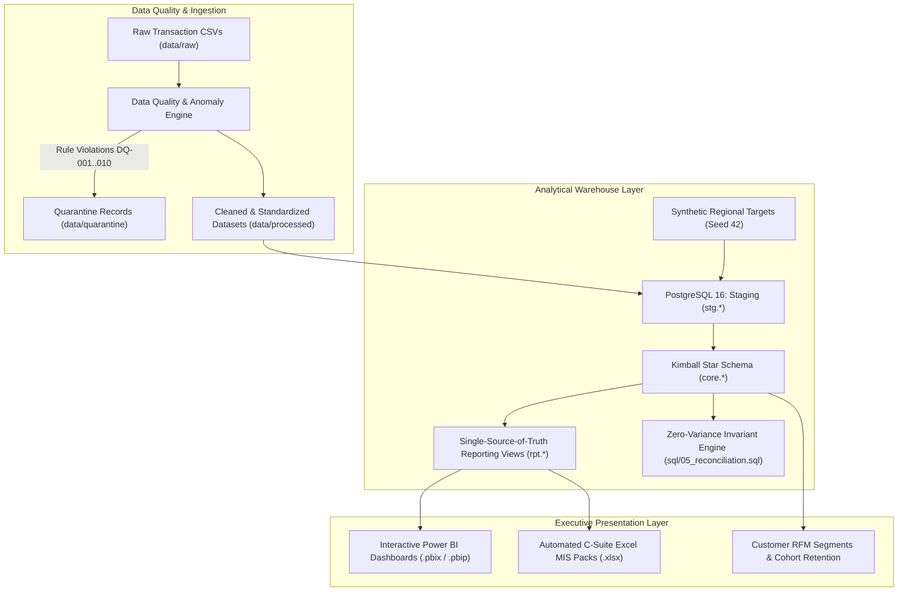

# Executive Sales & MIS Analytics Platform

[](powerbi/)
[](sql/)
[](python/)
[](reports/monthly_mis/)

An enterprise-grade business intelligence, analytics engineering, and Management Information System (MIS) platform. Transforms raw e-commerce transaction data (100k+ orders, $13.43M GMV) into an audited Kimball star schema data warehouse, single-source-of-truth SQL KPI views, interactive Power BI executive dashboards, and automated C-suite Excel reporting packs.

---

## 1. Executive Dashboard Showcase

The Power BI platform delivers an interactive two-page executive reporting suite designed for leadership decision-making.

```
Executive-Sales-MIS-Dashboard
├── Page 1: Executive Overview — Sales Operations & MIS Dashboard
└── Page 2: Regional Performance & Target Scorecard
```

### Page 1: Executive Overview — Sales Operations & MIS
Designed for C-suite operational monitoring, providing macro sales health, growth trends, and category performance:

* **Executive KPI Cards**:
  * **Gross Revenue**: **`$ 13.43M`** — Total company-wide delivered, shipped, invoiced, and approved sales.
  * **Total Orders**: **`98K`** (97,901) — Total revenue-bearing customer transactions.
  * **Average Order Value (AOV)**: **`$ 137.22`** — Unweighted true average order value calculated directly from underlying gross revenue divided by valid order volume.
  * **Cancellation Rate**: **`11.23%`** — Share of canceled and unavailable orders isolated from valid operational throughput.
* **Period-over-Period Performance Signals**:
  * **MoM Revenue Growth**: Dynamic month-over-month trajectory with automatic fallback to latest active operating month (`-3.32%` in August 2018; `+1.71%` in July 2018).
  * **YoY Revenue Growth**: Year-over-year expansion rate (`+50.53%` in August 2018 vs August 2017).
  * **Regional Superlatives**: Dynamic identification of top-grossing region (**Southeast**) and lowest target-achievement territory.
* **Monthly Revenue & Orders Trend (Dual-Axis Combo Chart)**:
  * Monthly gross revenue plotted as columns against total order volume as an overlaid trend line across all 25 reporting months (September 2016 – October 2018).
* **Top 10 Product Categories by Gross Revenue**:
  * Ranked breakdown highlighting core revenue drivers: Bed/Bath/Table, Health & Beauty, Computer Accessories, Furniture/Decor, and Sports/Leisure.

---

### Page 2: Regional Performance & Target Scorecard
Focuses on territorial sales execution, budget variance, and quota attainment across Brazil's 5 macro-regions:

* **Territorial Scorecard KPIs**:
  * **Actual Revenue**: **`$ 13.43M`**
  * **Target Revenue**: **`$ 14.26M`** (Synthetic budget baseline reflecting realistic corporate stretch targets)
  * **Target Achievement Rate**: **`94.20%`**
  * **Budget Variance**: **`($ 826.92K)`** planned stretch gap.
* **Regional Performance Status Matrix**:
  * Categorizes regions into **Above Target** ($\ge 100\%$), **Near Target** ($90\% - 99.9\%$), and **Below Target** ($< 90\%$).
  * Highlights target over-performance in North and Central-West regions alongside high-volume baseline shortfalls in the Southeast.
* **Regional Contribution Breakdown**:
  * Visualizes the geographic revenue distribution demonstrating Southeast dominance (**63.6%** of national GMV) followed by the South (**17.8%**) and Northeast (**11.4%**).

---

## 2. Key Business Insights & Strategic Takeaways

Detailed operational analyses and executive recommendations are documented in [EXECUTIVE_INSIGHTS.md](EXECUTIVE_INSIGHTS.md):

1. **Revenue Seasonality & Holiday Spikes**:
   * Peak revenue occurred during **Black Friday (November 2017)** reaching **`$ 999.3K`** (+52.3% MoM growth, 7,396 orders).
   * Post-holiday momentum established a sustained run rate averaging **`$ 850K – $990K`** monthly through mid-2018.

2. **Regional Revenue Dynamics & Target Allocation**:
   * **Southeast** generated **`$ 8.54M`** (63.6% of GMV), but missed aggressive stretch targets by $898K (90.5% achievement).
   * **North** and **Central-West** exceeded their sales targets (107.5% and 101.4% achievement respectively), highlighting high-growth territorial expansion opportunities.

3. **Customer Retention & RFM Segmentation**:
   * Analyzed 94k+ unique customers: 97.0% made a single purchase, indicating an acquisition-driven marketplace model.
   * Repeat customers generate a **`21% higher AOV`** ($166 vs $137), underscoring retention, loyalty programs, and post-purchase follow-up as the primary levers for lifetime value expansion.

---

## 3. End-to-End System Architecture



---

## 4. Enterprise Data Engineering Highlights

### 1. Kimball Star Schema Analytical Warehouse
* **Fact Tables**:
  * `core.fact_order`: Grain at order level with order timestamp keys, customer keys, revenue-bearing flags, and delivery status flags.
  * `core.fact_order_item`: Grain at line item level tracking product price, freight value, and seller surrogate keys.
* **Dimension Tables**:
  * `core.dim_date`: Complete dimensional calendar (2016–2018) with year, month, quarter, day of week, and month-end indicators.
  * `core.dim_customer`, `core.dim_product`, `core.dim_seller`, `core.dim_region`.

### 2. Zero-Variance Financial Reconciliation
* Implements mathematical invariant checks verifying that order item totals match parent order totals down to the penny with zero fanout join inflation.
* Reconciles financial figures across SQL views, Power BI DAX measures, and automated Excel workbooks.

### 3. Automated Executive MIS Reporting Packs (.xlsx)
* Built using Python (`openpyxl` & `xlsxwriter`) to generate multi-tab executive workbooks featuring:
  * Executive Summary with dynamic KPI cards.
  * Regional Performance tables with native conditional formatting (Green $\ge 100\%$, Amber $90\%-99.9\%$, Red $<90\%$).
  * Embedded native Excel combo charts and regional bar visual charts.

---

## 5. Repository Structure

```
Executive-Sales-MIS-Dashboard/
├── powerbi/
│   ├── p.pbix                          # Interactive compiled Power BI executive dashboard
│   ├── p_backup.pbip                   # Git-friendly Power BI project file (Developer Mode)
│   ├── p_backup.Report/                # Human-readable report visual configurations
│   ├── p_backup.SemanticModel/         # Human-readable semantic model & TMDL measures
│   └── report_definitions/             # Visual theme definitions & page JSON layouts
├── sql/
│   ├── 01_schema.sql                   # stg, core, rpt, audit schemas & table DDL
│   ├── 02_load_core.sql                # Star schema dimension & fact ETL with idempotent UPSERTs
│   ├── 03_kpi_views.sql                # Production KPI views (Monthly, Regional, Category)
│   ├── 04_analysis_queries.sql         # Strategic business analysis and Pareto ranking queries
│   ├── 05_reconciliation.sql          # Cross-tool reconciliation audits (0.00 variance checks)
│   └── 06_rfm_and_cohorts.sql         # RFM customer segmentation and cohort retention SQL views
├── python/
│   ├── config.py                       # Configuration loader, paths & DB connection pooling
│   ├── clean_data.py                   # Data cleaning, DQ rules, anomaly flags & quarantine
│   ├── generate_targets.py             # Synthetic regional sales targets generator (seed 42)
│   ├── generate_mis_report.py          # Automated C-suite Excel MIS pack generator (.xlsx)
│   ├── rfm_analytics.py                # RFM customer segmentation & cohort retention analyzer
│   ├── inspect_data.py                 # Profiling & SHA-256 provenance checksum generator
│   ├── load_database.py                # PostgreSQL schema & ETL star schema loader
│   ├── download_data.py                # Dataset acquisition & Kaggle API auto-downloader
│   └── run_pipeline.py                 # End-to-end master analytics orchestrator
├── reports/
│   ├── monthly_mis/                    # C-suite Excel MIS packs (.xlsx) & RFM reports (.md)
│   └── data_quality/                   # Profiling logs and audit health records (.md)
├── data/
│   ├── raw/                            # Read-only raw transaction data (.gitkeep)
│   ├── processed/                      # Cleaned and audited datasets (.gitkeep)
│   └── quarantine/                     # Excluded records with rule_id and reason codes (.gitkeep)
├── config.yaml                         # Central pipeline parameters and KPI rules
├── docker-compose.yml                  # PostgreSQL 16 container definition
├── requirements.txt                    # Pinned Python dependencies
├── EXECUTIVE_INSIGHTS.md               # Executive business insights & strategic recommendations
└── README.md                           # Executive presentation & system documentation
```
