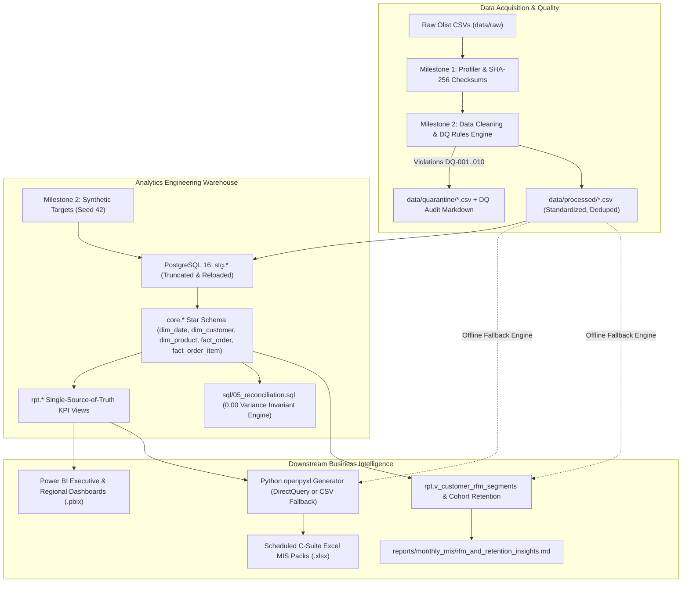

# Sales Operations & MIS Analytics Platform

[](https://github.com)
[](https://www.python.org/)
[-336791.svg)](https://www.postgresql.org/)
[](reports/monthly_mis/)

An enterprise-grade, end-to-end data analytics, Management Information System (MIS), and Analytics Engineering platform. Transforms raw e-commerce transaction data (99k+ orders, R$ 13.59M GMV) into audited analytical warehouses, Kimball star schemas, single-source-of-truth SQL KPI views, interactive Power BI executive dashboards, RFM customer segmentation, and scheduled multi-tab Excel MIS reporting packs.

---

## 1. System Architecture & Data Flow



---

## 2. Technology Stack

| Layer | Technology | Purpose |
|---|---|---|
| **Programming** | Python 3.11 - 3.14 | Cleaning engine, synthetic target modeling, openpyxl MIS pack builder, RFM analytics |
| **Warehouse** | PostgreSQL 16 (Docker) | Relational analytical warehouse: `stg`, `core` (Kimball Star Schema), `rpt`, `audit` |
| **Automation** | GitHub Actions CI & Make / PS1 | Automated continuous integration testing, one-click execution runners |
| **Spreadsheets** | openpyxl & xlsxwriter | C-suite multi-tab Excel workbooks with native charts and conditional KPI formatting |
| **BI Dashboards** | Power BI Desktop | DirectQuery & Import semantic models with executive overview and regional variance cards |

---

## 3. Quick Start & Execution

### Prerequisites
- Python 3.10+ installed
- Docker Desktop (optional for local database warehouse, offline CSV mode runs automatically if Docker is off)

### Option A: Windows PowerShell Task Runner
```powershell
# 1. Run end-to-end master analytics pipeline (Stages 1-6)
.\run_pipeline.ps1 pipeline

# 2. Generate monthly executive Excel MIS workbook
.\run_pipeline.ps1 report

# 3. Generate customer RFM segments & cohort retention
.\run_pipeline.ps1 rfm
```

### Option B: Cross-Platform Make
```bash
make install     # Install dependencies
make pipeline    # Run master pipeline
make report      # Generate Excel report
make rfm         # Run RFM & cohort analytics
```

### Option C: Manual Python Steps
```bash
# Activate virtual environment
.\venv\Scripts\Activate.ps1

# Run Master Orchestrator
python python/run_pipeline.py
```

---

## 4. Repository Structure

```
sales-ops-analytics/
├── .github/
│   └── workflows/ci.yml                # Automated GitHub Actions CI workflow
├── Makefile                            # Standard Unix/cross-platform task runner
├── run_pipeline.ps1                    # Native Windows PowerShell automation runner
├── config.yaml                         # Central pipeline parameters and KPI rules
├── docker-compose.yml                  # PostgreSQL 16 container definition with env vars
├── requirements.txt                    # Pinned Python dependencies
├── README.md                           # Comprehensive architecture and manual
├── EXECUTIVE_INSIGHTS.md               # Executive business insights & strategic recommendations
├── data/
│   ├── raw/                            # Read-only raw CSVs (Olist public dataset)
│   ├── processed/                      # Cleaned and audited datasets
│   ├── quarantine/                     # Excluded records with rule_id and reason codes
│   └── README.md                       # Data dictionary and licensing
├── python/
│   ├── config.py                       # Configuration loader, paths & DB connection pooling
│   ├── download_data.py                # Dataset acquisition & Kaggle API auto-downloader
│   ├── inspect_data.py                 # Profiling & SHA-256 provenance checksum generator
│   ├── generate_targets.py             # Synthetic regional sales targets generator (seed 42)
│   ├── clean_data.py                   # Data cleaning, DQ rules, anomaly flags & quarantine
│   ├── load_database.py                # PostgreSQL schema & ETL star schema loader
│   ├── generate_mis_report.py          # Automated C-suite Excel MIS pack generator (.xlsx)
│   ├── rfm_analytics.py                # RFM customer segmentation & cohort retention analyzer
│   └── run_pipeline.py                 # Master 1-click end-to-end orchestrator
├── sql/
│   ├── 01_schema.sql                   # stg, core, rpt, audit schemas & table definitions
│   ├── 02_load_core.sql                # Star schema dimension & fact ETL with idempotent UPSERTs
│   ├── 03_kpi_views.sql                # Production KPI reporting views (Monthly, Regional, Category)
│   ├── 04_analysis_queries.sql         # Strategic business analysis and Pareto ranking queries
│   ├── 05_reconciliation.sql          # Cross-tool reconciliation audits (0.00 variance checks)
│   └── 06_rfm_and_cohorts.sql         # RFM segmentation and cohort retention SQL views
├── powerbi/
│   ├── p.pbix                          # Interactive Power BI executive dashboard
│   ├── p_backup.pbip                   # Git-friendly Power BI project definition
│   ├── p_backup.Report/                # Human-readable report visual configurations
│   └── p_backup.SemanticModel/         # Human-readable semantic model & TMDL measures
└── reports/
    ├── data_quality/                   # Profiling logs and audit health records (.md)
    └── monthly_mis/                    # C-suite Excel MIS packs (.xlsx) & RFM reports (.md)
```

---

## 5. Core Deliverables & Enterprise Highlights

### 1. Robust Data Quality & Quarantine Architecture
- **Isolation over silent dropping**: Dirty rows (missing order IDs, duplicate keys, negative freight, negative price, orphan items) are isolated into `data/quarantine/` with `rule_id` and explanatory audit reasons.
- **Anomaly Flagging**: Delivery before purchase anomalies are preserved and tagged in `is_delivery_anomaly` for forensic tracking.

### 2. Dual-Engine Resilience (Database DirectQuery & Offline CSV Fallback)
- If the PostgreSQL Docker container is running, the system queries optimized relational views (`rpt.v_*`).
- If Docker is stopped, the pipeline falls back gracefully to in-memory Pandas analytical engines with zero disruption and sub-3s connection timeouts.

### 3. Kimball Dimensional Star Schema
- `core.dim_date`: Complete calendar dimension spanning 2016-2018 with ISO periods, day names, and month-end indicators.
- `core.dim_customer`, `core.dim_product`, `core.dim_seller`, `core.dim_region`.
- `core.fact_order`, `core.fact_order_item`, `core.fact_payment`, `core.fact_target`.
- Enforces strict referential integrity, surrogate keys, and B-tree indexes.

### 4. Zero-Variance Reconciliation Engine
- Verifies that `SUM(price)` in staging equals `SUM(price)` across dimensional facts.
- **Fanout prevention**: Ensures joining orders to multiple installment payments or review records does not artificially inflate reported revenue.

### 5. Automated Executive MIS Reporting Packs (.xlsx)
- Built using `openpyxl` with dynamic conditional formatting:
  - Green ($\ge 100\%$), Amber ($90\% - 99.9\%$), Red ($< 90\%$) target achievement highlighting.
  - Native Excel Bar Charts (Regional comparison) and Line Charts (Monthly revenue trajectory).
  - Executive KPI summary cards (Gross Revenue, Total Orders, AOV, MoM Growth).

### 6. Strategic RFM Segmentation & Cohort Retention
- Segments 94k+ customers into **Champions**, **Loyal Customers**, **Promising / New**, **Need Attention**, **At Risk**, and **Hibernating / Lost**.
- Calculates acquisition cohort retention showing marketplace retention dynamics.
- Detailed in [EXECUTIVE_INSIGHTS.md](EXECUTIVE_INSIGHTS.md).
```
